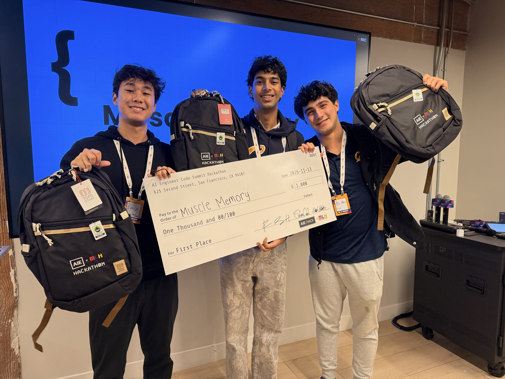

# Muscle Memory

**A software factory that turns slow thinking into reflexes.**

AIE x MLH Hackathon @ Code Summit · Bright Data, SF · Nov 13, 2026

🏆 **1st Place, AIE x MLH Hackathon @ Code Summit**



> **Live dashboard:** https://muscle-memory-mjivi.ondigitalocean.app · **Play:** https://muscle-memory-mjivi.ondigitalocean.app/#host

---

## In plain English

AI writes a lot of code now, and much of it is sloppy: padded with comments that restate the code, exceptions swallowed so bugs hide, debug prints left behind. Muscle Memory is an editor that cleans it up.

At first it thinks hard about every cut, which is slow and expensive. Every time a cut proves correct, it remembers. Once it has made the same call enough times, it writes the habit down as a simple rule, and from then on that call is instant and free.

It's how you learned to drive. At first you think through every move. Eventually it becomes muscle memory. We built that for AI, and you can watch it happen live.

*"How do you know the cuts are safe?"* Every cut is checked by running the code's tests, plus a second set of hidden tests the AI never sees. A cut that breaks anything is reverted.

## Results

Two Gemini coding agents (`gemini-4-hydrogen`, `gemini-3.5-flash-lite`) implemented the same 10 tickets on a small Python library (20 PRs). Muscle Memory cleaned every PR that passed its own tests.

| Tier | Decisions | Avg time per decision | Cost per decision |
|---|---|---|---|
| **Reflex**: a learned rule, no model | 11 | **0.05 ms** | $0 |
| **System 1**: Jev (TypeSafe) | 80 | **127 ms** | $0.00004 |
| **System 2**: Gemini 4 Hydrogen | 4 | **2,031 ms** | $0.003 |

- **Jev settled 80 of 84 model decisions on its own.** It's about 16× faster and about 80× cheaper than Gemini. Only answers Jev wasn't sure about (probability between 0.3 and 0.7) went to Gemini.
- **Two rules were learned live** from test-verified decisions: `restating_comment` and `swallowed_exception`.
- **The factory corrected its own mistake.** The swallowed-exception rule over-cut a function whose ticket *requires* returning `None` on bad input. The tests caught it, the rule was switched off, and Gemini rewrote it as v2, which excludes that case. All three steps are in the git history:
  ```
  reflex learned: mm-swallowed_exception-v1 (matches 5/5 CUT, 0/0 KEEP)
  reflex demoted: mm-swallowed_exception-v1 over-cut a hunk the tests needed
  reflex patched: mm-swallowed_exception-v2 (matches 5/5 CUT, 0/1 KEEP)
  ```
- **0 unsafe cuts shipped.** 1 bad cut was caught by the tests and reverted.
- **It fixed real bugs.** Cutting swallowed exceptions took hidden-test failures from 3 to 0 (on the seed PRs).
- **54 guard checks were kept** because the tickets or the code needed them. The one guard it cut passed every test. The factory doesn't just delete code.
- **2 agent PRs were rejected** before cleaning because they failed their own ticket's tests.

**Honest notes:**
- The 6 seed PRs in `data/seed/` are hand-written and labeled `seed` on the dashboard. They make the first rules appear on cue during a demo.
- The 20 agent PRs are real model output. They contained less slop than the seeds: Flash Lite's code was cut by 8% and Hydrogen's by under 1%, mostly comments that restate the code.

## How a decision works

```
agent PR ──► candidates found IN CODE (try/except that never re-raises, full-line comments,
             single-line if-guards, print calls). Models never decide what a candidate is.
               │
               ▼
   1. Reflex   learned rule matches?                         ~0.05 ms, $0
   2. Jev      atomic yes/no questions (Nouls) ──► truth table in code decides
   3. Gemini   only when a Jev answer is unsettled (0.3–0.7)   ~2 s
               │
               ▼
 VERIFY: apply the cut in a scratch copy, run public + hidden tests.
         Ships only if public tests stay green and hidden-test failures don't increase.
               │
               ▼
 LEARN:  5 verified cuts of one kind ──► Gemini writes a regex rule. It must match ≥80% of
         verified cuts and ZERO verified keeps, or it's rejected. Saved as Semgrep YAML in
         rules/ and committed to git.
 FIX:    a rule cut that breaks tests ──► rule switched off ──► Gemini writes v2.
 AUDIT:  15% of Jev/reflex calls are re-checked by Gemini.
```

- **Jev gives judgments, code decides.** Following TypeSafe's recommended pattern, Jev answers small, concrete questions such as *"Does the except block throw the error away so the caller never learns it happened?"* and *"Does the ticket ask for errors to be ignored?"*. The keep/cut decision is a readable truth table in [`factory/questions.py`](factory/questions.py).
- **Hidden tests** (`target/holdout/`) are never shown to any model. They answer the obvious question: "Did it just learn to game your tests?"
- **The rules are standard Semgrep YAML** (`pattern-regex`). Any team can run them in the CI they already have: `semgrep --config rules/ <path>`.

## Tracks

| Track | How Muscle Memory fits |
|---|---|
| **Best Use of System One Models** | Jev is the System 1 tier and settled 95% of model decisions. We follow TypeSafe's "judgments from Jev, decisions in code" pattern. Then we take the summit theme "System One models should become integrated with code" literally: Jev-verified habits compile into code rules. |
| **Cleanest Use of a Software Factory** | Agents → gate → clean merged code, with every cut verified by tests and hidden tests. **0 unsafe cuts shipped.** Every decision is logged, and every learned habit is a readable, versioned rule. |
| **Best Overall** | Real agent PRs, real tests, real numbers, and a factory that learns live and corrects its own mistake. |
| **Gemini** | Gemini 4 Hydrogen is System 2: it decides unsettled cases, writes rules, and rewrites rules that over-cut. Two Gemini models act as the coding agents. Gemini embeddings power similar-case lookup. |
| **Tiger Data** | One Postgres instance holds relational data (PRs, rules), vectors (pgvector, for similar past decisions) and time series (a `decisions` hypertable with a continuous aggregate and compression). The dashboard's Tiger panel runs one query that combines vector similarity with time, and compares continuous-aggregate speed with the raw query. |
| **Sentry** | Every Jev and Gemini call is wrapped in a `gen_ai` span with model and token counts. Each PR is a transaction. Enabled by setting `SENTRY_DSN`. |
| **DigitalOcean** | `scripts/make_prs.py` can add a third coding agent on DO Serverless Inference (`DO_INFERENCE_KEY`). The API serves the built dashboard, so it can deploy as one App Platform service. |

## Run it

```bash
uv sync && (cd web && npm install && npm run build)
cp .env.example .env                                   # fill keys (see comments in the file)
uv run scripts/smoke.py --apply-schema                 # one call per service + creates Tiger tables
uv run scripts/make_prs.py                             # coding agents x 11 tickets -> data/prs/
uv run uvicorn factory.api:app --port 8000             # dashboard at http://localhost:8000
```

In a second terminal, run the demo: seed PRs first, so rules appear on cue, then the real agent PRs:

```bash
uv run python -m factory.run --prs data/seed --reset --pace 0.6
uv run python -m factory.run --prs data/prs --pace 0.3
```

Other tools:
- `uv run scripts/probe_jev.py` sends 24 hand-written snippets through the Jev questions and prints each probability and verdict. We used it to tune the wording.
- `cd web && npm run dev` runs the dashboard with hot reload (proxies `/api` to :8000).

## Repo layout

```
factory/   the pipeline (Python)
  candidates.py   find candidates in code, apply fixes
  questions.py    every Jev question, criterion, threshold + the keep/cut truth table
  jev.py          System 1 (TypeSafe SDK)
  gemini.py       System 2 + rule writer + embeddings
  reflex.py       learned rules: load, match, validate, save as Semgrep YAML, git commit
  verify.py       scratch workspace + public/hidden test runs
  store.py        events.jsonl for the dashboard + Tiger Data writes
  run.py          the factory loop
  api.py          FastAPI: /api/state, /api/rules, /api/tiger, serves web/dist
target/    the `ledger` library the agents work on: tickets/, tests/, holdout/ (hidden)
rules/     learned Semgrep rules; their git history is what the factory learned
data/seed/ hand-written seed PRs (agent PRs and run logs are gitignored)
db/        schema.sql for Tiger Data (TimescaleDB + pgvector)
web/       React dashboard: decision timer, tier lanes, rule banner, rules/ + git log, Tiger panel
scripts/   smoke.py, make_prs.py, probe_jev.py
```

## Built with

Jev (TypeSafe AI) · Gemini 4 Hydrogen + Gemini 3.5 Flash Lite + Gemini embeddings · Tiger Data (TimescaleDB + pgvector) · Sentry · Semgrep · Python (FastAPI, pytest, uv) · React + Vite
